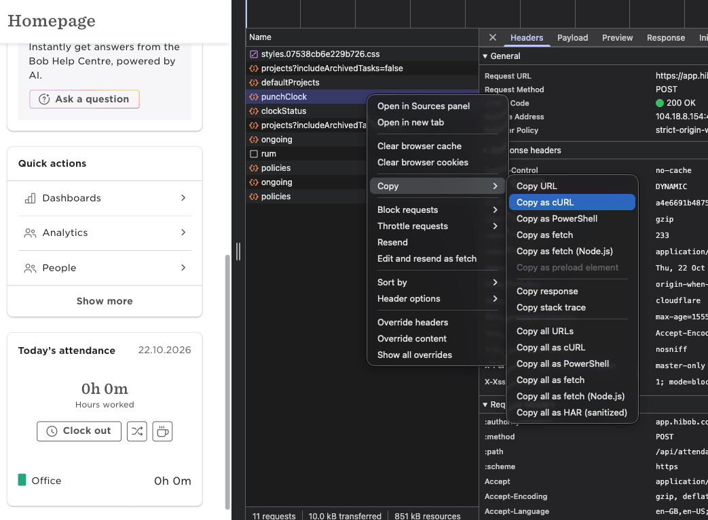

# HiBob Attendance CLI

`hibob.py` is a command-line tool for viewing attendance, listing attendance projects, and filling pending attendance days in HiBob. It uses Python's standard library and a current HiBob browser session stored in the local `curl.secret` file.

## Requirements

- Python 3.10 or newer.
- [uv](https://docs.astral.sh/uv/) for environment and dependency management.
- An active HiBob session with access to Attendance.
- A successful Attendance XHR request copied from your browser as cURL.

## Quick start

Set up the project environment and development tools:

```sh
uv sync --locked --group dev
```

Follow [Session setup and security](#session-setup-and-security) to create `curl.secret`, then run the CLI from the repository directory:

```sh
uv run python hibob.py
```

The project uses Python's standard library at runtime. `uv.lock` records the development tool versions for repeatable local setup.

## Session setup and security

1. Sign in to HiBob in Chrome and open the Attendance page.
2. Open Chrome DevTools (`⌘`+`Option`+`I` on macOS, or `Ctrl`+`Shift`+`I` on Windows/Linux) and select **Network**. DevTools records requests while this panel is open, so reload the Attendance page if needed.
3. Select the **Fetch/XHR** filter and find a successful Attendance request. Right-click its row and choose **Copy** → **Copy as cURL**, as shown here:

   

4. Create or open `curl.secret` in the repository root, paste the copied command as-is, and save the file. Restrict access to your account:

   ```sh
   chmod 600 curl.secret
   ```

The copied command contains session credentials, such as cookies or authorization headers. Treat `curl.secret` like a password; do not share or commit it. The script reads the cURL URL, headers, and cookies to authenticate its own requests. It does not replay the copied request or print its credentials. The session must still be valid on HiBob's servers; an unexpired token alone is not enough. See the [Chrome DevTools Network reference](https://developer.chrome.com/docs/devtools/network/reference/) for the Network panel, request filters, and copy options.

`.gitignore` excludes `curl.secret`, HAR captures, session files, backups, exports, and Python cache files. Remove local session captures when you no longer need them, and log out of HiBob yourself when finished.

## Usage

Run these commands from the repository directory. `--action show` is the default. If `--month` is omitted, the tool selects the previous month on days 1–5 and the current month on all other days. `--month` accepts a number from 1 to 12 and uses the current year.

### View attendance

```sh
# Show the attendance table for the default month
uv run python hibob.py

# Show a month number in the current year
uv run python hibob.py --month 10
```

The attendance table shows each date as `FILLED`, `PENDING`, `NON-WORKING`, or `NO DATA`. `NO DATA` means HiBob returned no daily row; the tool does not infer that the date is available to fill.

### List attendance projects

```sh
uv run python hibob.py --action show-projects
```

Use a project ID shown by this command when filling attendance.
You can also pass the exact project name with `--project-alias`; this avoids needing to run `show-projects` first.

### Fill attendance

```sh
# Fill pending days through yesterday with split intervals
uv run python hibob.py --action fill-time-attendance --project-id PROJECT_ID --schedule "08:00 - 14:00, 15:00 - 17:00"

# Use the exact project name instead of its ID
uv run python hibob.py --action fill-time-attendance --project-alias "Project Name" --schedule "08:00 - 14:00, 15:00 - 17:00"

# Add a break interval between work intervals
uv run python hibob.py --action fill-time-attendance --project-id PROJECT_ID --schedule "8-14,15-17" --break-schedule "14-15"

# The shorter hour-only form is also accepted; this fills October
uv run python hibob.py --action fill-time-attendance --month 10 --project-id PROJECT_ID --schedule "8-14,15-17"

# Replace existing attendance entries in the selected month
uv run python hibob.py --action fill-time-attendance --month 10 --project-id PROJECT_ID --schedule "8-14,15-17" --overwrite

# Use shorter Fridays and a different Friday break
uv run python hibob.py --action fill-time-attendance --project-id PROJECT_ID --schedule "Mon-Thu 8-13,14-17:30 Fri 8-14" --break-schedule "Mon-Thu 13-14 Fri 12-12:30"

# Preview the per-day hours summary in the terminal
uv run python hibob.py --action fill-time-attendance --project-id PROJECT_ID --schedule "8-12,13-17" --dry-run

# Preview using a project name
uv run python hibob.py --action fill-time-attendance --project-alias "Project Name" --schedule "8-12,13-17" --dry-run
```

`--schedule` takes comma-separated 24-hour work intervals. Enter each as `HH:MM - HH:MM` or as `H-H` with omitted minutes treated as `:00`. For example, `08:00 - 14:00, 15:00 - 17:00` and `8-14,15-17` mean the same thing. To vary hours by weekday, prefix each group with a day or inclusive weekday range, such as `Mon-Thu 8-13,14-17:30 Fri 8-14`. Weekday names are case-insensitive three-letter English names. Grouped work schedules must specify every weekday from Monday through Friday; Saturday and Sunday are skipped. The plain interval form remains a schedule applied to every day. `--break-schedule` accepts the same formats; in a grouped break schedule, omitted days have no break intervals. Each interval must end after it starts, intervals within a schedule cannot overlap, and overnight intervals are not supported.

The fill action:

- Requires exactly one of `--project-id` or `--project-alias`. An alias is an exact project-name match, ignoring case and surrounding whitespace. The script maps it using the project list fetched for the fill, so you do not need to run `--action show-projects` separately. If names are duplicated, use `--project-id` to identify the intended project.
- Accepts optional `--break-schedule`; each interval is submitted as an `entryType: "break"` entry with no project ID.
- Writes only dates through yesterday that HiBob reports as `PENDING` in the selected month.
- In default mode, skips dates already filled, weekends, holidays, time off, dates without a report row, today, and future dates.
- Checks that the timesheet is open before writing.
- Saves a private backup under the ignored `backups/` directory, rereads each date before updating it, and reads attendance back to verify the intervals and project.

This action writes attendance to HiBob. In default mode, if a request fails partway through, rerunning it skips dates that are already filled.

`--dry-run` uses the same project, schedule, status, and date selection as the fill action, but does not change attendance or create a backup. It requires exactly one of `--project-id` or `--project-alias`. It prints a per-day summary of included dates, work intervals, break intervals, and hours. Work hours exclude breaks, which are totaled separately. With `--overwrite`, the preview includes filled weekdays throughout the selected month plus pending weekdays through yesterday, matching the overwrite action.

`--overwrite` is restricted to `--action fill-time-attendance`. It replaces each target weekday's full entry list with the requested schedule and project. Existing entries later in the selected month are included; pending dates are still filled only through yesterday. Weekends are skipped. A backup of every target day's prior row is saved before writing.

## Testing and checks

Run the unit tests with:

```sh
uv run --locked --group dev python -m unittest discover -s tests -v
```

Tests use synthetic session data and mocked network calls, so they need no `curl.secret` or live HiBob credentials.

Check the script with Ruff:

```sh
uv run --locked --group dev ruff check hibob.py
uv run --locked --group dev ruff format --check
```

## API reference

[reference/api/README.md](reference/api/README.md) describes endpoints observed in a local HiBob HAR capture, with request and response shapes and a short purpose for each endpoint. These are private web-app endpoints, not a stable public API; response formats and permissions can change.
